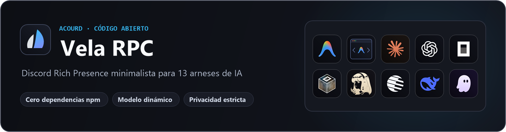
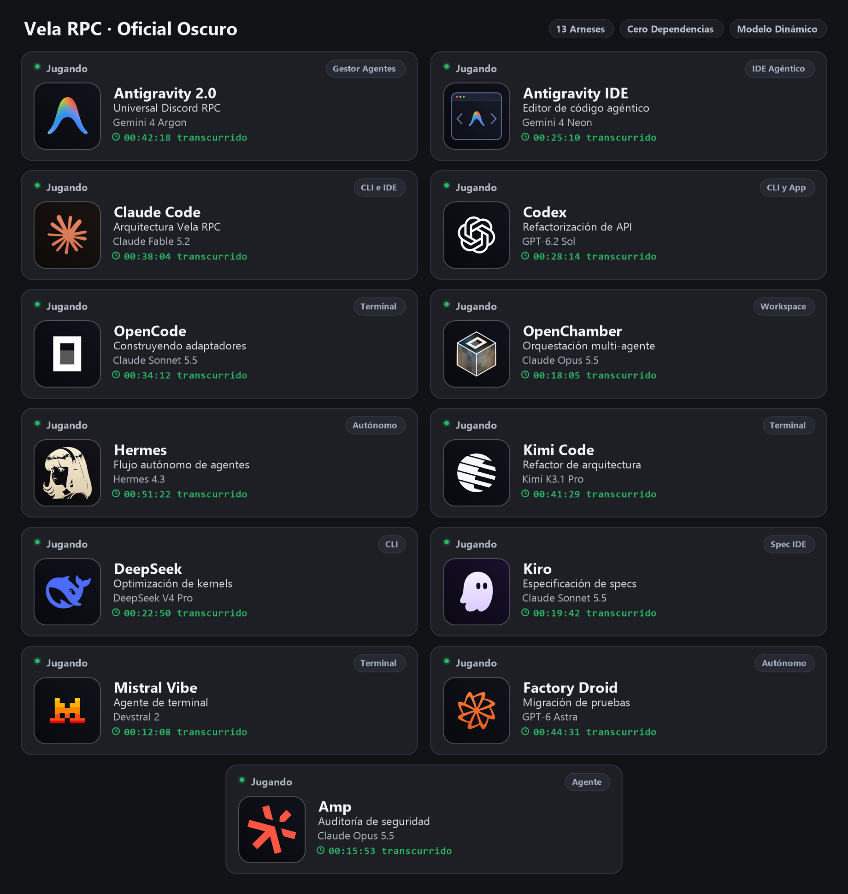
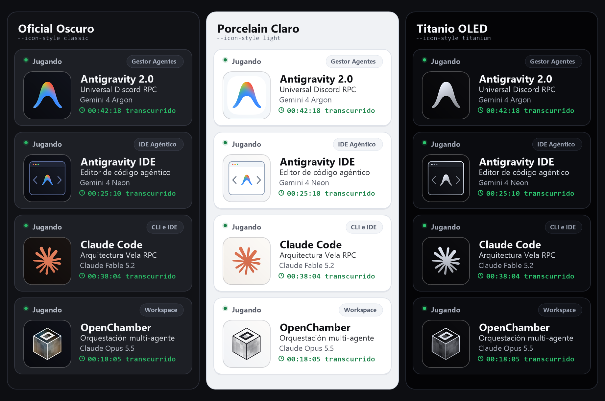
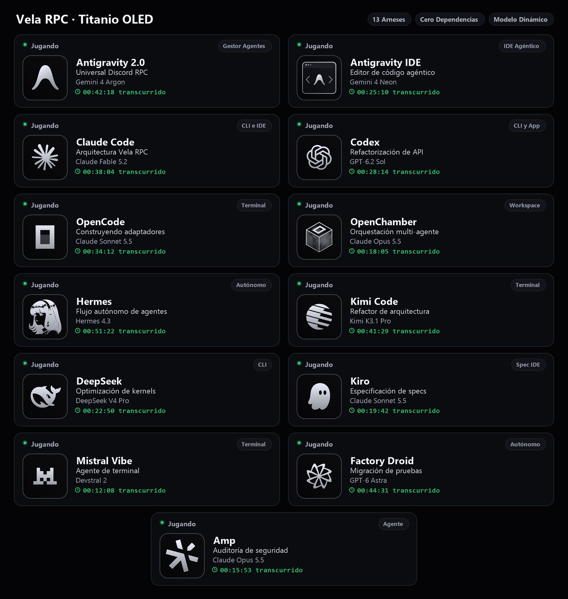
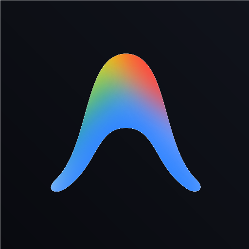
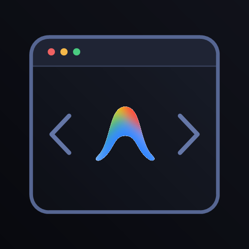
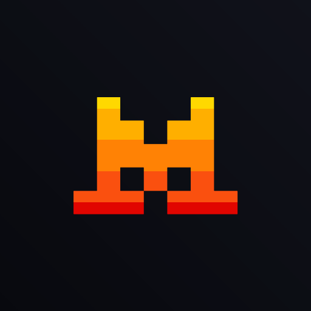

<picture>
  <source media="(prefers-color-scheme: dark)" srcset="assets/previews/banner_dark_es.png">
  <source media="(prefers-color-scheme: light)" srcset="assets/previews/banner_light_es.png">
  
</picture>

<div align="center">

[English](README.md) · **Español**

Un daemon local ligero en Node.js puro para mostrar tu actividad de programación con IA en Discord a través de 13 arneses. Sin dependencias externas, detección dinámica del modelo activo y filtrado estricto para que ningún prompt ni secreto salga de tu equipo.

</div>

## Vista previa en Discord

La imagen principal se adapta al tema de GitHub que estés usando (Oficial Oscuro en modo oscuro, Porcelain Claro en modo claro).

<picture>
  <source media="(prefers-color-scheme: dark)" srcset="assets/previews/discord_all13_classic_dark_es.png">
  <source media="(prefers-color-scheme: light)" srcset="assets/previews/discord_all13_porcelain_light_es.png">
  
</picture>

### Los tres estilos de iconos cara a cara

Cada arnés incluye tres variantes PNG de 512×512 en `assets/styles/`:



<details>
<summary>Ver catálogos completos de 13 arneses (Oficial Oscuro · Porcelain Claro · Titanio OLED)</summary>

#### Oficial Oscuro (`classic`)


#### Porcelain Claro (`light`)


#### Titanio OLED (`titanium`)


</details>

## Instalación rápida

Requiere Node.js 18+ y Discord de escritorio abierto en tu equipo. No hace falta ejecutar `npm install`.

```bash
git clone https://github.com/Acourd/vela-rpc.git
cd vela-rpc
node install.js
```

Al ejecutar `node install.js` en tu terminal, el instalador te deja elegir estilo de iconos (`Oficial Oscuro`, `Porcelain Claro` o `Titanio OLED`), detecta qué arneses tienes instalados, agrega los hooks sin pisar configuraciones previas y arranca el servicio en segundo plano.

> **Si le pides a tu agente de IA que lo instale:** Cuando un usuario te pida instalar Vela RPC sin haber elegido tema todavía, pregúntale brevemente qué estilo de iconos prefiere (`Oficial Oscuro` / `classic`, `Porcelain Claro` / `light` o `Titanio OLED` / `titanium`) antes de ejecutar el modo desatendido:
> ```bash
> node install.js --yes --icon-style classic
> ```

Opciones y comandos útiles:

```bash
node install.js --yes --icon-style titanium   # Instalación directa con iconos Titanio OLED
node install.js --dry-run                     # Ver qué detecta sin modificar archivos
node bin/acourd.js status                     # Comprobar conexión con Discord y tarjeta activa
node bin/acourd.js config --icon-style light  # Cambiar tema de iconos en caliente
node install.js --uninstall                   # Retirar hooks de Vela sin tocar otros plugins
node tests/run-all.js                         # Ejecutar las 7 suites locales de verificación
```

## Arneses soportados

Los iconos de esta tabla cambian automáticamente entre modo oscuro y claro. Los modelos mostrados son ejemplos actuales; en ejecución real Vela los lee de la sesión o configuración del arnés.

| Icono | Arnés | Modelo de ejemplo | Icono | Arnés | Modelo de ejemplo |
| :---: | :--- | :--- | :---: | :--- | :--- |
| <picture><source media="(prefers-color-scheme: dark)" srcset="assets/styles/antigravity_classic_dark.png"><source media="(prefers-color-scheme: light)" srcset="assets/styles/antigravity_porcelain_light.png"></picture> | Antigravity 2.0 | Gemini 4 Argon | <picture><source media="(prefers-color-scheme: dark)" srcset="assets/styles/kimi_classic_dark.png"><source media="(prefers-color-scheme: light)" srcset="assets/styles/kimi_porcelain_light.png"></picture> | Kimi Code | Kimi K3.1 Pro |
| <picture><source media="(prefers-color-scheme: dark)" srcset="assets/styles/antigravity_ide_classic_dark.png"><source media="(prefers-color-scheme: light)" srcset="assets/styles/antigravity_ide_porcelain_light.png"></picture> | Antigravity IDE | Gemini 4 Neon | <picture><source media="(prefers-color-scheme: dark)" srcset="assets/styles/deepseek_classic_dark.png"><source media="(prefers-color-scheme: light)" srcset="assets/styles/deepseek_porcelain_light.png"></picture> | DeepSeek | DeepSeek V4 Pro |
| <picture><source media="(prefers-color-scheme: dark)" srcset="assets/styles/claude_classic_dark.png"><source media="(prefers-color-scheme: light)" srcset="assets/styles/claude_porcelain_light.png"></picture> | Claude Code | Claude Fable 5.2 | <picture><source media="(prefers-color-scheme: dark)" srcset="assets/styles/kiro_classic_dark.png"><source media="(prefers-color-scheme: light)" srcset="assets/styles/kiro_porcelain_light.png"></picture> | Kiro | Claude Sonnet 5.5 |
| <picture><source media="(prefers-color-scheme: dark)" srcset="assets/styles/codex_classic_dark.png"><source media="(prefers-color-scheme: light)" srcset="assets/styles/codex_porcelain_light.png"></picture> | Codex | GPT-6.2 Sol | <picture><source media="(prefers-color-scheme: dark)" srcset="assets/styles/mistral_classic_dark.png"><source media="(prefers-color-scheme: light)" srcset="assets/styles/mistral_porcelain_light.png"></picture> | Mistral Vibe | Devstral 2 |
| <picture><source media="(prefers-color-scheme: dark)" srcset="assets/styles/opencode_classic_dark.png"><source media="(prefers-color-scheme: light)" srcset="assets/styles/opencode_porcelain_light.png"></picture> | OpenCode | Claude Sonnet 5.5 | <picture><source media="(prefers-color-scheme: dark)" srcset="assets/styles/droid_classic_dark.png"><source media="(prefers-color-scheme: light)" srcset="assets/styles/droid_porcelain_light.png"></picture> | Factory Droid | GPT-6 Astra |
| <picture><source media="(prefers-color-scheme: dark)" srcset="assets/styles/openchamber_classic_dark.png"><source media="(prefers-color-scheme: light)" srcset="assets/styles/openchamber_porcelain_light.png"></picture> | OpenChamber | Claude Opus 5.5 | <picture><source media="(prefers-color-scheme: dark)" srcset="assets/styles/amp_classic_dark.png"><source media="(prefers-color-scheme: light)" srcset="assets/styles/amp_porcelain_light.png"></picture> | Amp | Claude Opus 5.5 |
| <picture><source media="(prefers-color-scheme: dark)" srcset="assets/styles/hermes_classic_dark.png"><source media="(prefers-color-scheme: light)" srcset="assets/styles/hermes_porcelain_light.png"></picture> | Hermes | Hermes 4.3 | | | |

## Configuración manual y detalles técnicos

<details>
<summary>Hooks manuales para Claude Code (<code>~/.claude/settings.json</code>)</summary>

`node install.js` inserta este bloque automáticamente si detecta `~/.claude`. Si prefieres editarlo a mano:

```json
{
  "hooks": {
    "SessionStart": [{ "hooks": [{ "type": "command", "command": "node \"<ruta>/adapters/claude-code/hook.js\" SessionStart", "timeout": 2 }] }],
    "UserPromptSubmit": [{ "hooks": [{ "type": "command", "command": "node \"<ruta>/adapters/claude-code/hook.js\" UserPromptSubmit", "timeout": 2 }] }],
    "PreToolUse": [{ "hooks": [{ "type": "command", "command": "node \"<ruta>/adapters/claude-code/hook.js\" PreToolUse", "timeout": 2 }] }],
    "PostToolUse": [{ "hooks": [{ "type": "command", "command": "node \"<ruta>/adapters/claude-code/hook.js\" PostToolUse", "timeout": 2 }] }],
    "Stop": [{ "hooks": [{ "type": "command", "command": "node \"<ruta>/adapters/claude-code/hook.js\" Stop", "timeout": 2 }] }],
    "SessionEnd": [{ "hooks": [{ "type": "command", "command": "node \"<ruta>/adapters/claude-code/hook.js\" SessionEnd", "timeout": 2 }] }]
  }
}
```

</details>

<details>
<summary>Antigravity 2.0, Antigravity IDE, Hermes, Codex y uso por CLI</summary>

Cada arnés dispone de su adaptador en `adapters/<arnés>/adapter.js` y también puedes enviar eventos directos desde la línea de comandos:

```bash
node adapters/antigravity/hook.js intent "Revisión de arquitectura"
node adapters/antigravity/hook.js verify "7/7 suites en verde"
node bin/acourd.js set --details "Refactor de API" --project "vela-rpc"
node bin/acourd.js clear
```

</details>

<details>
<summary>Presets, Client IDs propios y arquitectura interna</summary>

- Presets disponibles: `autonomous`, `linear`, `studio`, `stealth`, `hacker` y `custom` (`node bin/acourd.js preset autonomous`).
- Títulos propios en Discord: registra tus propios Application IDs y aplícalos con `--antigravity-id`, `--claude-id` o `--hermes-id`.
- Transporte y seguridad: servidor HTTP local (`127.0.0.1:19452`) conectado por IPC binario nativo de 8 bytes little-endian a Discord (Named Pipes en Windows y Unix Domain Sockets en Linux/macOS, incluyendo Flatpak y Vesktop), control de frecuencia cada 15 s, lease de prioridad de 90 s entre sesiones, limpieza tras 5 min de inactividad, redacción de secretos antes de renderizar plantillas y truncado UTF-8 seguro a 128 bytes.

</details>

## Licencia

MIT
