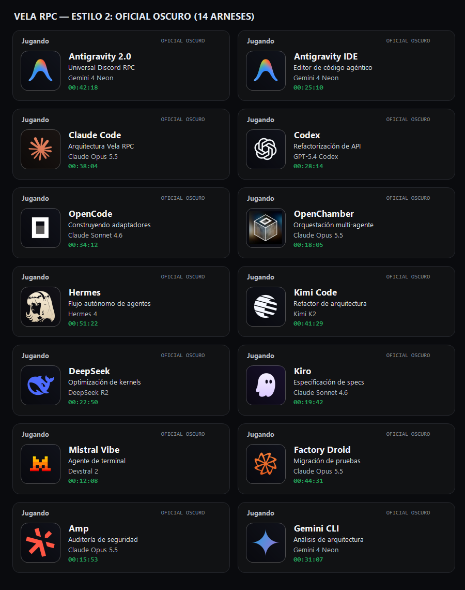
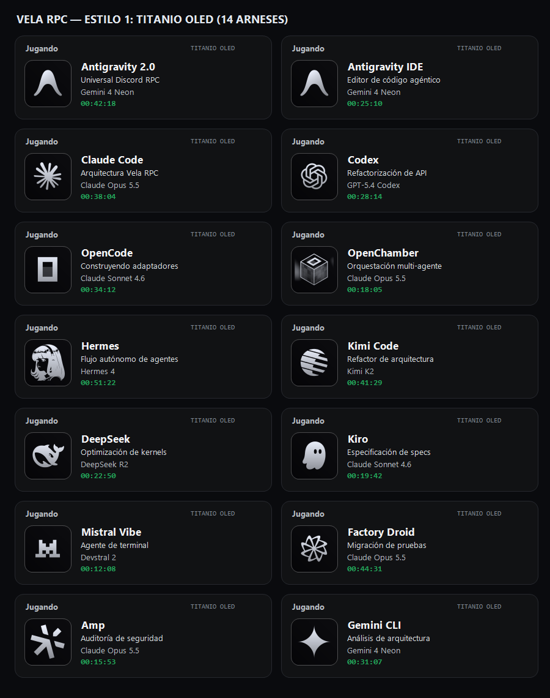
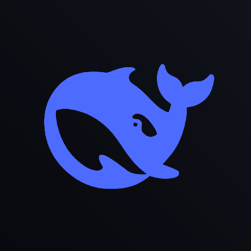
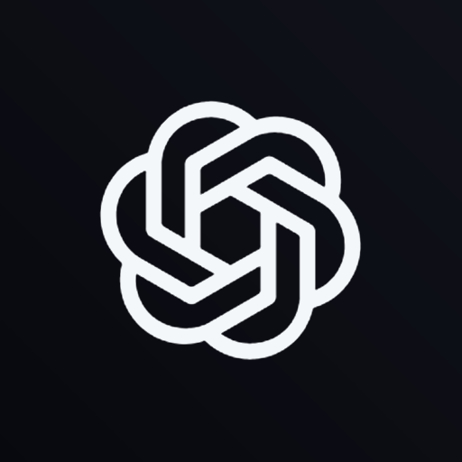

# Vela RPC

[English](README.md) · **Español**

Discord Rich Presence minimalista para arneses de programación con IA. Un solo daemon local en Node.js sin dependencias externas cubre 14 herramientas, lee el modelo y el título real de la sesión, y nunca envía prompts ni secretos a Discord.

## Vista previa en Discord

La imagen cambia de forma automática según el tema de GitHub que uses (en modo oscuro muestra Oficial Oscuro; en modo claro muestra Porcelain Claro).

<picture>
  <source media="(prefers-color-scheme: dark)" srcset="assets/previews/discord_all14_classic_dark.png">
  <source media="(prefers-color-scheme: light)" srcset="assets/previews/discord_all14_porcelain_light.png">
  
</picture>

<details>
<summary>Ver estilo Titanio OLED</summary>



</details>

## Instalación

Requiere Node.js 18+ y Discord de escritorio en ejecución. No hace falta ejecutar `npm install`.

```bash
git clone https://github.com/Acourd/vela-rpc.git
cd vela-rpc

# Verificar la suite local (6/6 suites con servidor IPC simulado)
node tests/run-all.js

# Iniciar el daemon en segundo plano
node bin/acourd.js start

# Consultar estado activo
node bin/acourd.js status
```

## Selector de iconos (oscuro / claro / titanio)

Cada arnés incluye tres variantes PNG de 512×512 en `assets/styles/`: `classic` (Oficial Oscuro), `light` (Porcelain Claro) y `titanium` (Titanio OLED). Puedes cambiar el estilo en caliente sin reiniciar el daemon:

```bash
node bin/acourd.js config --icon-style titanium   # Titanio OLED
node bin/acourd.js config --icon-style classic    # Oficial Oscuro
node bin/acourd.js config --icon-style light      # Porcelain Claro
```

### Arneses soportados

Los iconos de esta tabla cambian automáticamente entre modo oscuro y claro en GitHub:

| Icono | Arnés | Modelo base | Icono | Arnés | Modelo base |
| :---: | :--- | :--- | :---: | :--- | :--- |
| <picture><source media="(prefers-color-scheme: dark)" srcset="assets/styles/antigravity_classic_dark.png"><source media="(prefers-color-scheme: light)" srcset="assets/styles/antigravity_porcelain_light.png"></picture> | Antigravity 2.0 / IDE | Gemini 4 Neon | <picture><source media="(prefers-color-scheme: dark)" srcset="assets/styles/kimi_classic_dark.png"><source media="(prefers-color-scheme: light)" srcset="assets/styles/kimi_porcelain_light.png"></picture> | Kimi Code | Kimi K2 |
| <picture><source media="(prefers-color-scheme: dark)" srcset="assets/styles/claude_classic_dark.png"><source media="(prefers-color-scheme: light)" srcset="assets/styles/claude_porcelain_light.png"></picture> | Claude Code | Claude Opus 5.5 | <picture><source media="(prefers-color-scheme: dark)" srcset="assets/styles/deepseek_classic_dark.png"><source media="(prefers-color-scheme: light)" srcset="assets/styles/deepseek_porcelain_light.png"></picture> | DeepSeek | DeepSeek R2 |
| <picture><source media="(prefers-color-scheme: dark)" srcset="assets/styles/codex_classic_dark.png"><source media="(prefers-color-scheme: light)" srcset="assets/styles/codex_porcelain_light.png"></picture> | Codex | GPT-5.4 Codex | <picture><source media="(prefers-color-scheme: dark)" srcset="assets/styles/kiro_classic_dark.png"><source media="(prefers-color-scheme: light)" srcset="assets/styles/kiro_porcelain_light.png"></picture> | Kiro | Claude Sonnet 4.6 |
| <picture><source media="(prefers-color-scheme: dark)" srcset="assets/styles/opencode_classic_dark.png"><source media="(prefers-color-scheme: light)" srcset="assets/styles/opencode_porcelain_light.png"></picture> | OpenCode | Claude Sonnet 4.6 | <picture><source media="(prefers-color-scheme: dark)" srcset="assets/styles/mistral_classic_dark.png"><source media="(prefers-color-scheme: light)" srcset="assets/styles/mistral_porcelain_light.png"></picture> | Mistral Vibe | Devstral 2 |
| <picture><source media="(prefers-color-scheme: dark)" srcset="assets/styles/openchamber_classic_dark.png"><source media="(prefers-color-scheme: light)" srcset="assets/styles/openchamber_porcelain_light.png"></picture> | OpenChamber | Claude Opus 5.5 | <picture><source media="(prefers-color-scheme: dark)" srcset="assets/styles/droid_classic_dark.png"><source media="(prefers-color-scheme: light)" srcset="assets/styles/droid_porcelain_light.png"></picture> | Factory Droid | Claude Opus 5.5 |
| <picture><source media="(prefers-color-scheme: dark)" srcset="assets/styles/hermes_classic_dark.png"><source media="(prefers-color-scheme: light)" srcset="assets/styles/hermes_porcelain_light.png"></picture> | Hermes | Hermes 4 | <picture><source media="(prefers-color-scheme: dark)" srcset="assets/styles/amp_classic_dark.png"><source media="(prefers-color-scheme: light)" srcset="assets/styles/amp_porcelain_light.png"></picture> | Amp | Claude Opus 5.5 |
| <picture><source media="(prefers-color-scheme: dark)" srcset="assets/styles/gemini_cli_classic_dark.png"><source media="(prefers-color-scheme: light)" srcset="assets/styles/gemini_cli_porcelain_light.png"></picture> | Gemini CLI | Gemini 4 Neon | | | |

## Configuración de adaptadores

<details>
<summary>Claude Code (<code>~/.claude/settings.json</code>)</summary>

```json
{
  "hooks": {
    "SessionStart": [{ "command": "node \"<path>/bin/acourd.js\" hook SessionStart" }],
    "UserPromptSubmit": [{ "command": "node \"<path>/bin/acourd.js\" hook UserPromptSubmit" }],
    "PreToolUse": [{ "command": "node \"<path>/bin/acourd.js\" hook PreToolUse" }],
    "PostToolUse": [{ "command": "node \"<path>/bin/acourd.js\" hook PostToolUse" }],
    "Stop": [{ "command": "node \"<path>/bin/acourd.js\" hook Stop" }],
    "SessionEnd": [{ "command": "node \"<path>/bin/acourd.js\" hook SessionEnd" }]
  }
}
```

</details>

<details>
<summary>Antigravity 2.0 y Antigravity IDE</summary>

```bash
node adapters/antigravity/hook.js intent "Revisión de arquitectura"
node adapters/antigravity/hook.js verify "6/6 suites en verde"
```

</details>

<details>
<summary>Hermes, Codex, OpenCode, OpenChamber, Kimi Code, DeepSeek y otros</summary>

Cada arnés tiene su adaptador en `adapters/<arnés>/adapter.js` y también puedes enviar eventos directos desde la CLI:

```bash
node bin/acourd.js set --source codex --task "Refactor de API" --model "GPT-5.4 Codex"
node bin/acourd.js clear
```

</details>

<details>
<summary>Presets, Client IDs propios y detalles de arquitectura</summary>

- Presets disponibles: `autonomous` (título limpio + modelo activo), `telemetry`, `linear`, `studio`, `stealth`, `hacker` y `custom`. Se aplican con `node bin/acourd.js preset autonomous`.
- Títulos personalizados en Discord: puedes registrar tus propios Client IDs y asignarlos con `--antigravity-id`, `--claude-id` o `--hermes-id` en `node bin/acourd.js config`.
- Transporte: servidor HTTP local (`127.0.0.1:19452`) conectado por IPC binario nativo de 8 bytes LE a Discord (Named Pipes en Windows y Unix Domain Sockets en Linux/macOS, incluyendo Flatpak y Vesktop), límite de frecuencia de 15 s, lease de prioridad de 90 s entre sesiones, limpieza automática tras 5 min de inactividad y truncado UTF-8 seguro a 128 bytes.

</details>

## Licencia

MIT
