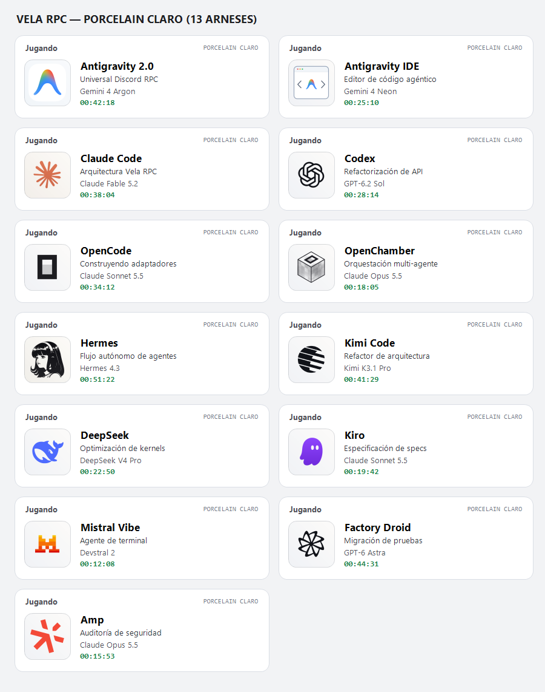
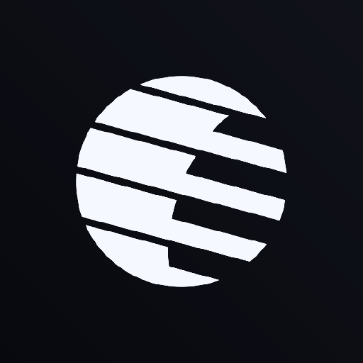
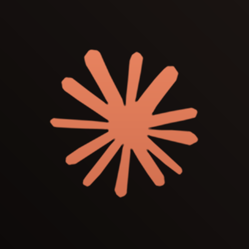
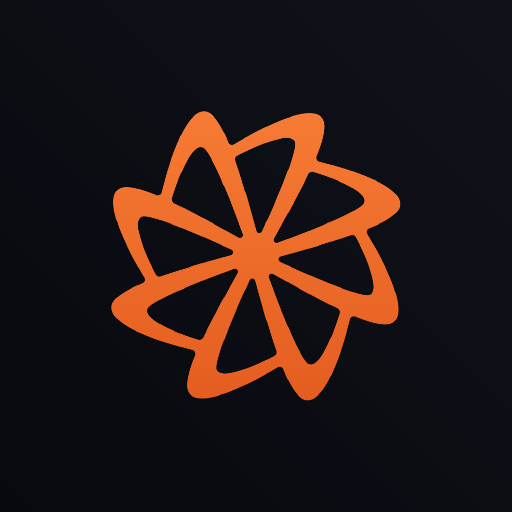
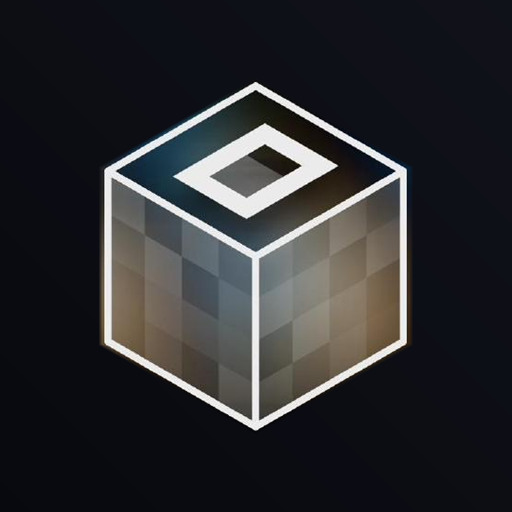
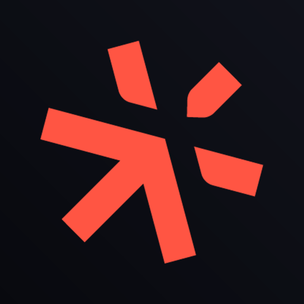
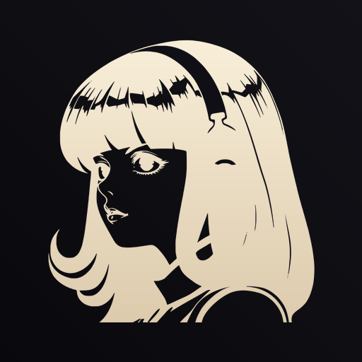

# Vela RPC

[English](README.md) · **Español**

Discord Rich Presence minimalista para arneses de programación con IA. Un solo daemon local en Node.js sin dependencias externas cubre 13 herramientas, detecta dinámicamente el modelo y el título real de la sesión, y filtra prompts y secretos antes de que salgan de tu equipo.

## Vista previa en Discord

La imagen superior cambia según tu tema de GitHub (Oficial Oscuro en modo oscuro, Porcelain Claro en modo claro). Debajo puedes ver también las tres variantes juntas sin importar qué tema tengas activo.

<picture>
  <source media="(prefers-color-scheme: dark)" srcset="assets/previews/discord_all13_classic_dark_es.png">
  <source media="(prefers-color-scheme: light)" srcset="assets/previews/discord_all13_porcelain_light_es.png">
  
</picture>

| Oficial Oscuro | Porcelain Claro |
| :---: | :---: |
|  |  |

<details>
<summary>Ver estilo Titanio OLED</summary>


</details>

## Instalación

Requiere Node.js 18+ y Discord de escritorio en ejecución. No hace falta ejecutar `npm install`.

```bash
git clone https://github.com/Acourd/vela-rpc.git
cd vela-rpc

# Verificar la suite local (7/7 suites con servidor IPC simulado)
node tests/run-all.js

# Iniciar el daemon en segundo plano
node bin/acourd.js start

# Consultar estado activo
node bin/acourd.js status
```

## Selector de iconos (oscuro / claro / titanio)

Cada arnés incluye tres variantes PNG de 512×512 en `assets/styles/`: `classic` (Oficial Oscuro), `light` (Porcelain Claro) y `titanium` (Titanio OLED). Cambia el estilo en caliente sin reiniciar el daemon:

```bash
node bin/acourd.js config --icon-style titanium   # Titanio OLED
node bin/acourd.js config --icon-style classic    # Oficial Oscuro
node bin/acourd.js config --icon-style light      # Porcelain Claro
```

### Arneses soportados

Los iconos de esta tabla cambian automáticamente entre modo oscuro y claro en GitHub:

| Icono | Arnés | Modelo de ejemplo | Icono | Arnés | Modelo de ejemplo |
| :---: | :--- | :--- | :---: | :--- | :--- |
| <picture><source media="(prefers-color-scheme: dark)" srcset="assets/styles/antigravity_classic_dark.png"><source media="(prefers-color-scheme: light)" srcset="assets/styles/antigravity_porcelain_light.png"></picture> | Antigravity 2.0 | Gemini 4 Argon | <picture><source media="(prefers-color-scheme: dark)" srcset="assets/styles/kimi_classic_dark.png"><source media="(prefers-color-scheme: light)" srcset="assets/styles/kimi_porcelain_light.png"></picture> | Kimi Code | Kimi K3.1 Pro |
| <picture><source media="(prefers-color-scheme: dark)" srcset="assets/styles/antigravity_ide_classic_dark.png"><source media="(prefers-color-scheme: light)" srcset="assets/styles/antigravity_ide_porcelain_light.png"></picture> | Antigravity IDE | Gemini 4 Neon | <picture><source media="(prefers-color-scheme: dark)" srcset="assets/styles/deepseek_classic_dark.png"><source media="(prefers-color-scheme: light)" srcset="assets/styles/deepseek_porcelain_light.png"></picture> | DeepSeek | DeepSeek V4 Pro |
| <picture><source media="(prefers-color-scheme: dark)" srcset="assets/styles/claude_classic_dark.png"><source media="(prefers-color-scheme: light)" srcset="assets/styles/claude_porcelain_light.png"></picture> | Claude Code | Claude Fable 5.2 | <picture><source media="(prefers-color-scheme: dark)" srcset="assets/styles/kiro_classic_dark.png"><source media="(prefers-color-scheme: light)" srcset="assets/styles/kiro_porcelain_light.png"></picture> | Kiro | Claude Sonnet 5.5 |
| <picture><source media="(prefers-color-scheme: dark)" srcset="assets/styles/codex_classic_dark.png"><source media="(prefers-color-scheme: light)" srcset="assets/styles/codex_porcelain_light.png"></picture> | Codex | GPT-6.2 Sol | <picture><source media="(prefers-color-scheme: dark)" srcset="assets/styles/mistral_classic_dark.png"><source media="(prefers-color-scheme: light)" srcset="assets/styles/mistral_porcelain_light.png"></picture> | Mistral Vibe | Devstral 2 |
| <picture><source media="(prefers-color-scheme: dark)" srcset="assets/styles/opencode_classic_dark.png"><source media="(prefers-color-scheme: light)" srcset="assets/styles/opencode_porcelain_light.png"></picture> | OpenCode | Claude Sonnet 5.5 | <picture><source media="(prefers-color-scheme: dark)" srcset="assets/styles/droid_classic_dark.png"><source media="(prefers-color-scheme: light)" srcset="assets/styles/droid_porcelain_light.png"></picture> | Factory Droid | GPT-6 Astra |
| <picture><source media="(prefers-color-scheme: dark)" srcset="assets/styles/openchamber_classic_dark.png"><source media="(prefers-color-scheme: light)" srcset="assets/styles/openchamber_porcelain_light.png"></picture> | OpenChamber | Claude Opus 5.5 | <picture><source media="(prefers-color-scheme: dark)" srcset="assets/styles/amp_classic_dark.png"><source media="(prefers-color-scheme: light)" srcset="assets/styles/amp_porcelain_light.png"></picture> | Amp | Claude Opus 5.5 |
| <picture><source media="(prefers-color-scheme: dark)" srcset="assets/styles/hermes_classic_dark.png"><source media="(prefers-color-scheme: light)" srcset="assets/styles/hermes_porcelain_light.png"></picture> | Hermes | Hermes 4.3 | | | |

## Configuración de adaptadores

<details>
<summary>Claude Code (<code>~/.claude/settings.json</code>)</summary>

```json
{
  "hooks": {
    "SessionStart": [{ "command": "node \"<path>/bin/acourd.js\" hook SessionStart" }],
    "UserPromptSubmit": [{ "command": "node \"<path>/bin/acourd.js\" hook UserPromptSubmit" }],
    "PreToolUse": [{ "command": "node \"<path>/bin/acourd.js\" hook PreToolUse" }],
    "PostToolUse": [{ "command": "node \"<path>/bin/acourd.js\" hook PostToolUse" }],
    "Stop": [{ "command": "node \"<path>/bin/acourd.js\" hook Stop" }],
    "SessionEnd": [{ "command": "node \"<path>/bin/acourd.js\" hook SessionEnd" }]
  }
}
```

</details>

<details>
<summary>Antigravity 2.0 y Antigravity IDE</summary>

```bash
node adapters/antigravity/hook.js intent "Revisión de arquitectura"
node adapters/antigravity/hook.js verify "7/7 suites en verde"
```

</details>

<details>
<summary>Hermes, Codex, OpenCode, OpenChamber, Kimi Code, DeepSeek y otros</summary>

Cada arnés tiene su adaptador en `adapters/<arnés>/adapter.js` y también puedes enviar eventos directos desde la CLI:

```bash
node bin/acourd.js set --source codex --task "Refactor de API" --model "GPT-6.2 Sol"
node bin/acourd.js clear
```

</details>

<details>
<summary>Presets, Client IDs propios y detalles de arquitectura</summary>

- Presets disponibles: `autonomous` (título limpio + modelo activo), `telemetry`, `linear`, `studio`, `stealth`, `hacker` y `custom`. Se aplican con `node bin/acourd.js preset autonomous`.
- Títulos personalizados en Discord: registra tus propios Client IDs y asígnalos con `--antigravity-id`, `--claude-id` o `--hermes-id` en `node bin/acourd.js config`.
- Transporte: servidor HTTP local (`127.0.0.1:19452`) conectado por IPC binario nativo de 8 bytes LE a Discord (Named Pipes en Windows y Unix Domain Sockets en Linux/macOS, incluyendo Flatpak y Vesktop), límite de frecuencia de 15 s, lease de prioridad de 90 s entre sesiones, limpieza automática tras 5 min de inactividad y truncado UTF-8 seguro a 128 bytes.

</details>

## Licencia

MIT
