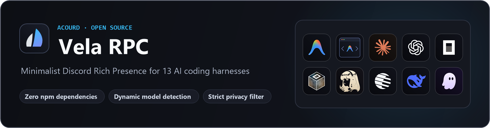
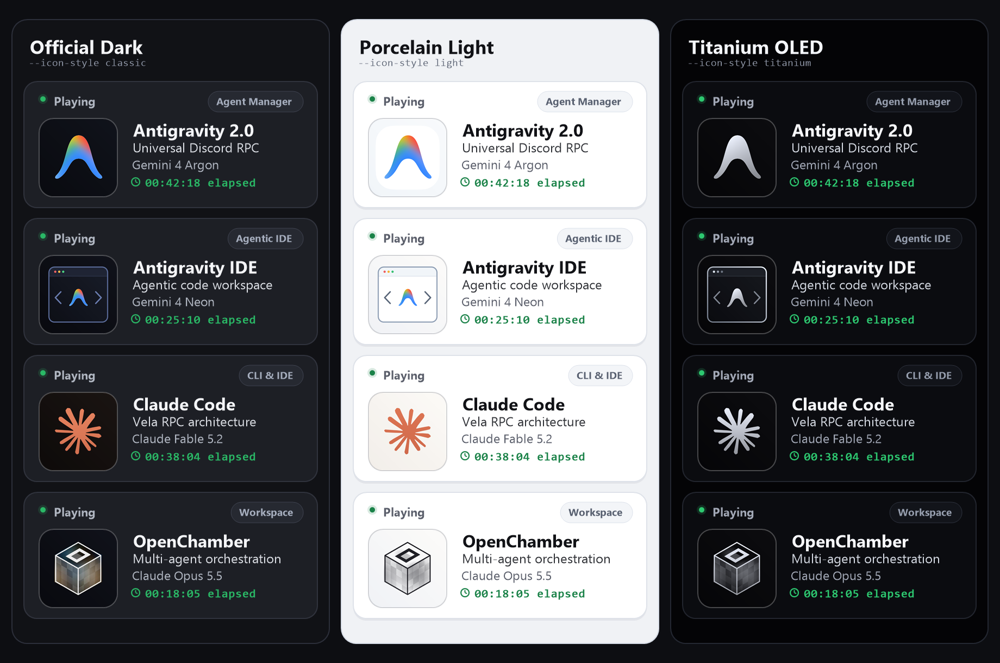
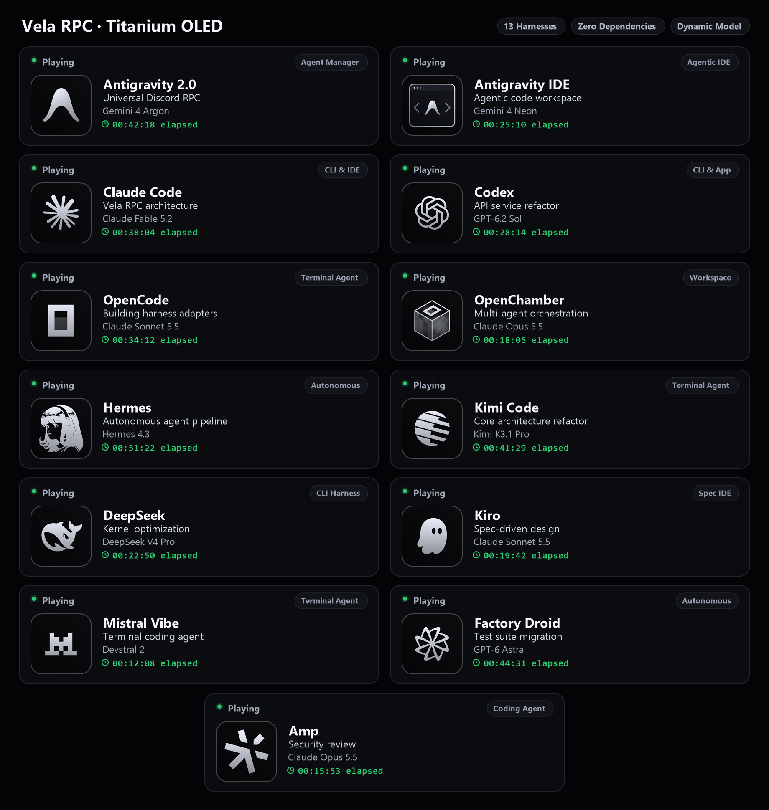
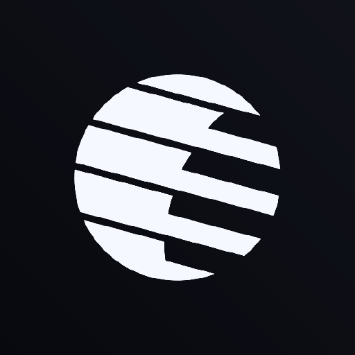
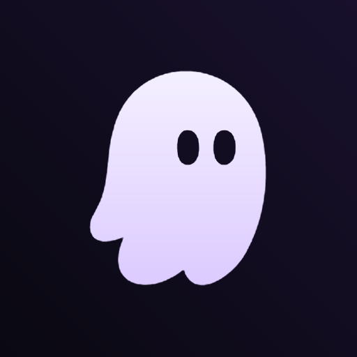
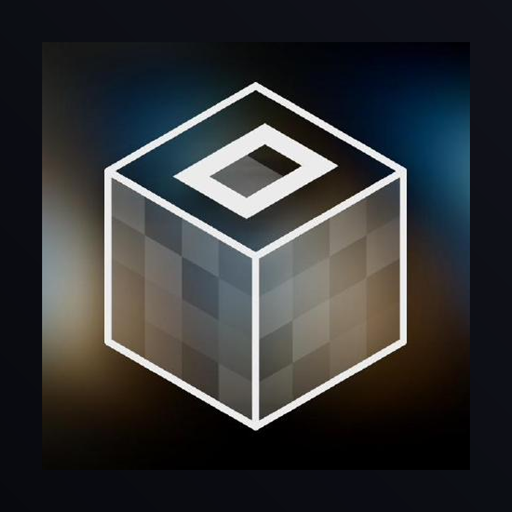
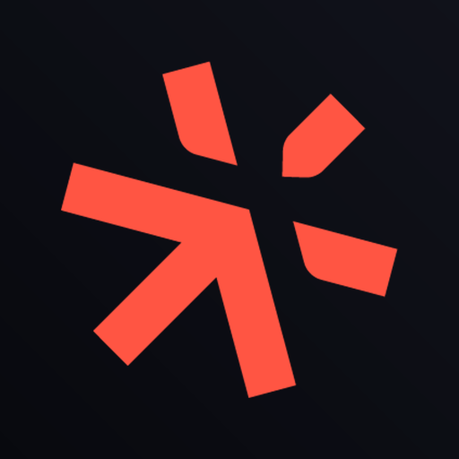
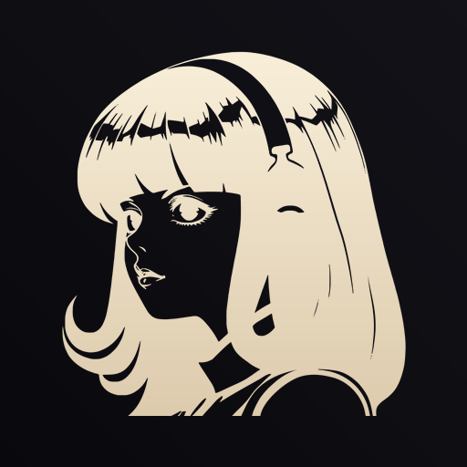

<picture>
  <source media="(prefers-color-scheme: dark)" srcset="assets/previews/banner_dark_en.png">
  <source media="(prefers-color-scheme: light)" srcset="assets/previews/banner_light_en.png">
  
</picture>

<div align="center">

**English** · [Español](README.es.md)

A lightweight local daemon in plain Node.js that broadcasts live Discord Rich Presence across 13 AI coding harnesses. No npm dependencies, dynamic model detection straight from your active session, and strict filtering so prompts and secrets stay on your machine.

</div>

## Discord preview

The preview below matches your GitHub theme automatically (Official Dark in dark mode, Porcelain Light in light mode).

<picture>
  <source media="(prefers-color-scheme: dark)" srcset="assets/previews/discord_all13_classic_dark_en.png">
  <source media="(prefers-color-scheme: light)" srcset="assets/previews/discord_all13_porcelain_light_en.png">
  
</picture>

### All three icon packs side by side

Every harness ships with three 512×512 PNG variants in `assets/styles/`:



<details>
<summary>Open full 13-harness views (Official Dark · Porcelain Light · Titanium OLED)</summary>

#### Official Dark (`classic`)


#### Porcelain Light (`light`)


#### Titanium OLED (`titanium`)


</details>

## Quick setup

Requires Node.js 18+ and Discord desktop running locally. No `npm install` needed.

```bash
git clone https://github.com/Acourd/vela-rpc.git
cd vela-rpc
node install.js
```

Running `node install.js` in a terminal lets you pick an icon pack (`Official Dark`, `Porcelain Light`, or `Titanium OLED`), detects which AI harnesses you have installed, safely merges Vela hooks into existing configurations without overwriting your setup, and starts the background daemon.

> **Installing with an AI coding agent:** If the user asked you to set up Vela RPC and has not named a theme yet, briefly ask which icon style they want (`Official Dark` / `classic`, `Porcelain Light` / `light`, or `Titanium OLED` / `titanium`) before running the non-interactive command:
> ```bash
> node install.js --yes --icon-style classic
> ```

Useful flags and everyday commands:

```bash
node install.js --yes --icon-style titanium   # Non-interactive install with Titanium OLED icons
node install.js --dry-run                     # Preview detected harnesses without writing files
node bin/acourd.js status                     # Check Discord IPC connection and active card
node bin/acourd.js config --icon-style light  # Switch icon theme live without restarting
node install.js --uninstall                   # Remove Vela hooks cleanly
node tests/run-all.js                         # Run all 7 local test suites
```

## Supported harnesses

Icons in this table adapt to your GitHub theme. The example models reflect live detection defaults and read dynamically from active sessions or local config files when running.

| Icon | Harness | Example model | Icon | Harness | Example model |
| :---: | :--- | :--- | :---: | :--- | :--- |
| <picture><source media="(prefers-color-scheme: dark)" srcset="assets/styles/antigravity_classic_dark.png"><source media="(prefers-color-scheme: light)" srcset="assets/styles/antigravity_porcelain_light.png"></picture> | Antigravity 2.0 | Gemini 4 Argon | <picture><source media="(prefers-color-scheme: dark)" srcset="assets/styles/kimi_classic_dark.png"><source media="(prefers-color-scheme: light)" srcset="assets/styles/kimi_porcelain_light.png"></picture> | Kimi Code | Kimi K3.1 Pro |
| <picture><source media="(prefers-color-scheme: dark)" srcset="assets/styles/antigravity_ide_classic_dark.png"><source media="(prefers-color-scheme: light)" srcset="assets/styles/antigravity_ide_porcelain_light.png"></picture> | Antigravity IDE | Gemini 4 Neon | <picture><source media="(prefers-color-scheme: dark)" srcset="assets/styles/deepseek_classic_dark.png"><source media="(prefers-color-scheme: light)" srcset="assets/styles/deepseek_porcelain_light.png"></picture> | DeepSeek | DeepSeek V4 Pro |
| <picture><source media="(prefers-color-scheme: dark)" srcset="assets/styles/claude_classic_dark.png"><source media="(prefers-color-scheme: light)" srcset="assets/styles/claude_porcelain_light.png"></picture> | Claude Code | Claude Fable 5.2 | <picture><source media="(prefers-color-scheme: dark)" srcset="assets/styles/kiro_classic_dark.png"><source media="(prefers-color-scheme: light)" srcset="assets/styles/kiro_porcelain_light.png"></picture> | Kiro | Claude Sonnet 5.5 |
| <picture><source media="(prefers-color-scheme: dark)" srcset="assets/styles/codex_classic_dark.png"><source media="(prefers-color-scheme: light)" srcset="assets/styles/codex_porcelain_light.png"></picture> | Codex | GPT-6.2 Sol | <picture><source media="(prefers-color-scheme: dark)" srcset="assets/styles/mistral_classic_dark.png"><source media="(prefers-color-scheme: light)" srcset="assets/styles/mistral_porcelain_light.png"></picture> | Mistral Vibe | Devstral 2 |
| <picture><source media="(prefers-color-scheme: dark)" srcset="assets/styles/opencode_classic_dark.png"><source media="(prefers-color-scheme: light)" srcset="assets/styles/opencode_porcelain_light.png"></picture> | OpenCode | Claude Sonnet 5.5 | <picture><source media="(prefers-color-scheme: dark)" srcset="assets/styles/droid_classic_dark.png"><source media="(prefers-color-scheme: light)" srcset="assets/styles/droid_porcelain_light.png"></picture> | Factory Droid | GPT-6 Astra |
| <picture><source media="(prefers-color-scheme: dark)" srcset="assets/styles/openchamber_classic_dark.png"><source media="(prefers-color-scheme: light)" srcset="assets/styles/openchamber_porcelain_light.png"></picture> | OpenChamber | Claude Opus 5.5 | <picture><source media="(prefers-color-scheme: dark)" srcset="assets/styles/amp_classic_dark.png"><source media="(prefers-color-scheme: light)" srcset="assets/styles/amp_porcelain_light.png"></picture> | Amp | Claude Opus 5.5 |
| <picture><source media="(prefers-color-scheme: dark)" srcset="assets/styles/hermes_classic_dark.png"><source media="(prefers-color-scheme: light)" srcset="assets/styles/hermes_porcelain_light.png"></picture> | Hermes | Hermes 4.3 | | | |

## Manual adapter wiring and technical details

<details>
<summary>Claude Code manual hook config (<code>~/.claude/settings.json</code>)</summary>

`node install.js` writes this block safely on its own when `~/.claude` exists. If you prefer manual editing:

```json
{
  "hooks": {
    "SessionStart": [{ "hooks": [{ "type": "command", "command": "node \"<path>/adapters/claude-code/hook.js\" SessionStart", "timeout": 2 }] }],
    "UserPromptSubmit": [{ "hooks": [{ "type": "command", "command": "node \"<path>/adapters/claude-code/hook.js\" UserPromptSubmit", "timeout": 2 }] }],
    "PreToolUse": [{ "hooks": [{ "type": "command", "command": "node \"<path>/adapters/claude-code/hook.js\" PreToolUse", "timeout": 2 }] }],
    "PostToolUse": [{ "hooks": [{ "type": "command", "command": "node \"<path>/adapters/claude-code/hook.js\" PostToolUse", "timeout": 2 }] }],
    "Stop": [{ "hooks": [{ "type": "command", "command": "node \"<path>/adapters/claude-code/hook.js\" Stop", "timeout": 2 }] }],
    "SessionEnd": [{ "hooks": [{ "type": "command", "command": "node \"<path>/adapters/claude-code/hook.js\" SessionEnd", "timeout": 2 }] }]
  }
}
```

</details>

<details>
<summary>Antigravity 2.0, Antigravity IDE, Hermes, Codex and CLI usage</summary>

Each harness ships an adapter under `adapters/<harness>/adapter.js` or can send events directly from the CLI:

```bash
node adapters/antigravity/hook.js intent "Architecture review"
node adapters/antigravity/hook.js verify "7/7 suites passing"
node bin/acourd.js set --details "API refactor" --project "vela-rpc"
node bin/acourd.js clear
```

</details>

<details>
<summary>Presets, custom Discord Client IDs and architecture</summary>

- Presets: `autonomous`, `linear`, `studio`, `stealth`, `hacker`, and `custom` (`node bin/acourd.js preset autonomous`).
- Custom Discord app titles: register your own Discord Application IDs and set them with `--antigravity-id`, `--claude-id`, or `--hermes-id`.
- Transport & safety: loopback HTTP server (`127.0.0.1:19452`) bridged to native 8-byte little-endian Discord IPC (Windows Named Pipes and Unix Domain Sockets, including Flatpak and Vesktop), 15s debounce, 90s multi-session priority lease, 5-minute stale cleanup, secret redaction before templating, and 128-byte UTF-8 boundary truncation.

</details>

## License

MIT
