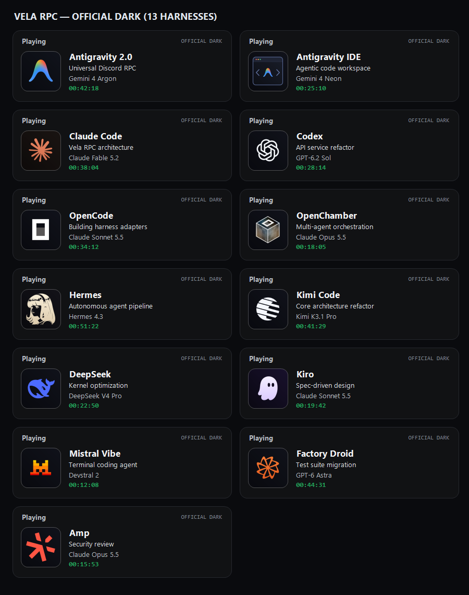
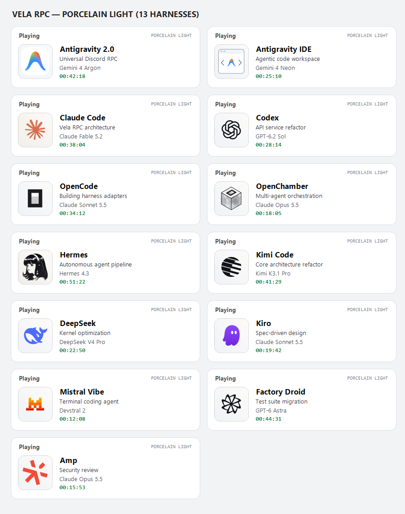

# Vela RPC

**English** · [Español](README.es.md)

Minimalist Discord Rich Presence for AI coding harnesses. One local Node.js daemon with zero npm dependencies tracks 13 tools, reads the active model and session title dynamically, and strips prompts and secrets before anything leaves your machine.

## Discord preview

The header preview adapts to your GitHub theme (Official Dark in dark mode, Porcelain Light in light mode). All three icon packs are also shown below so you can inspect light, dark, and OLED variants regardless of your current theme.

<picture>
  <source media="(prefers-color-scheme: dark)" srcset="assets/previews/discord_all13_classic_dark_en.png">
  <source media="(prefers-color-scheme: light)" srcset="assets/previews/discord_all13_porcelain_light_en.png">
  
</picture>

| Official Dark | Porcelain Light |
| :---: | :---: |
|  |  |

<details>
<summary>View Titanium OLED preview</summary>


</details>

## Installation

Requires Node.js 18+ and a local Discord desktop client. No `npm install` needed.

```bash
git clone https://github.com/Acourd/vela-rpc.git
cd vela-rpc

# Verify the local test suite (7/7 suites, mock Discord IPC)
node tests/run-all.js

# Start the background daemon
node bin/acourd.js start

# Check active status
node bin/acourd.js status
```

## Icon theme switch (dark / light / titanium)

Every harness ships with three 512×512 PNG variants in `assets/styles/`: `classic` (Official Dark), `light` (Porcelain Light), and `titanium` (Titanium OLED). Switch the active style at runtime without restarting the daemon:

```bash
node bin/acourd.js config --icon-style titanium   # Titanium OLED
node bin/acourd.js config --icon-style classic    # Official Dark
node bin/acourd.js config --icon-style light      # Porcelain Light
```

### Supported harnesses

Icons in this table switch automatically between dark and light mode on GitHub:

| Icon | Harness | Example model | Icon | Harness | Example model |
| :---: | :--- | :--- | :---: | :--- | :--- |
| <picture><source media="(prefers-color-scheme: dark)" srcset="assets/styles/antigravity_classic_dark.png"><source media="(prefers-color-scheme: light)" srcset="assets/styles/antigravity_porcelain_light.png"></picture> | Antigravity 2.0 | Gemini 4 Argon | <picture><source media="(prefers-color-scheme: dark)" srcset="assets/styles/kimi_classic_dark.png"><source media="(prefers-color-scheme: light)" srcset="assets/styles/kimi_porcelain_light.png"></picture> | Kimi Code | Kimi K3.1 Pro |
| <picture><source media="(prefers-color-scheme: dark)" srcset="assets/styles/antigravity_ide_classic_dark.png"><source media="(prefers-color-scheme: light)" srcset="assets/styles/antigravity_ide_porcelain_light.png"></picture> | Antigravity IDE | Gemini 4 Neon | <picture><source media="(prefers-color-scheme: dark)" srcset="assets/styles/deepseek_classic_dark.png"><source media="(prefers-color-scheme: light)" srcset="assets/styles/deepseek_porcelain_light.png"></picture> | DeepSeek | DeepSeek V4 Pro |
| <picture><source media="(prefers-color-scheme: dark)" srcset="assets/styles/claude_classic_dark.png"><source media="(prefers-color-scheme: light)" srcset="assets/styles/claude_porcelain_light.png"></picture> | Claude Code | Claude Fable 5.2 | <picture><source media="(prefers-color-scheme: dark)" srcset="assets/styles/kiro_classic_dark.png"><source media="(prefers-color-scheme: light)" srcset="assets/styles/kiro_porcelain_light.png"></picture> | Kiro | Claude Sonnet 5.5 |
| <picture><source media="(prefers-color-scheme: dark)" srcset="assets/styles/codex_classic_dark.png"><source media="(prefers-color-scheme: light)" srcset="assets/styles/codex_porcelain_light.png"></picture> | Codex | GPT-6.2 Sol | <picture><source media="(prefers-color-scheme: dark)" srcset="assets/styles/mistral_classic_dark.png"><source media="(prefers-color-scheme: light)" srcset="assets/styles/mistral_porcelain_light.png"></picture> | Mistral Vibe | Devstral 2 |
| <picture><source media="(prefers-color-scheme: dark)" srcset="assets/styles/opencode_classic_dark.png"><source media="(prefers-color-scheme: light)" srcset="assets/styles/opencode_porcelain_light.png"></picture> | OpenCode | Claude Sonnet 5.5 | <picture><source media="(prefers-color-scheme: dark)" srcset="assets/styles/droid_classic_dark.png"><source media="(prefers-color-scheme: light)" srcset="assets/styles/droid_porcelain_light.png"></picture> | Factory Droid | GPT-6 Astra |
| <picture><source media="(prefers-color-scheme: dark)" srcset="assets/styles/openchamber_classic_dark.png"><source media="(prefers-color-scheme: light)" srcset="assets/styles/openchamber_porcelain_light.png"></picture> | OpenChamber | Claude Opus 5.5 | <picture><source media="(prefers-color-scheme: dark)" srcset="assets/styles/amp_classic_dark.png"><source media="(prefers-color-scheme: light)" srcset="assets/styles/amp_porcelain_light.png"></picture> | Amp | Claude Opus 5.5 |
| <picture><source media="(prefers-color-scheme: dark)" srcset="assets/styles/hermes_classic_dark.png"><source media="(prefers-color-scheme: light)" srcset="assets/styles/hermes_porcelain_light.png"></picture> | Hermes | Hermes 4.3 | | | |

## Adapter configuration

<details>
<summary>Claude Code (<code>~/.claude/settings.json</code>)</summary>

```json
{
  "hooks": {
    "SessionStart": [{ "command": "node \"<path>/bin/acourd.js\" hook SessionStart" }],
    "UserPromptSubmit": [{ "command": "node \"<path>/bin/acourd.js\" hook UserPromptSubmit" }],
    "PreToolUse": [{ "command": "node \"<path>/bin/acourd.js\" hook PreToolUse" }],
    "PostToolUse": [{ "command": "node \"<path>/bin/acourd.js\" hook PostToolUse" }],
    "Stop": [{ "command": "node \"<path>/bin/acourd.js\" hook Stop" }],
    "SessionEnd": [{ "command": "node \"<path>/bin/acourd.js\" hook SessionEnd" }]
  }
}
```

</details>

<details>
<summary>Antigravity 2.0 and Antigravity IDE</summary>

```bash
node adapters/antigravity/hook.js intent "Architecture review"
node adapters/antigravity/hook.js verify "7/7 suites passing"
```

</details>

<details>
<summary>Hermes, Codex, OpenCode, OpenChamber, Kimi Code, DeepSeek and others</summary>

Each harness exposes a standalone adapter under `adapters/<harness>/adapter.js` or can push events directly from the CLI:

```bash
node bin/acourd.js set --source codex --task "API refactor" --model "GPT-6.2 Sol"
node bin/acourd.js clear
```

</details>

<details>
<summary>Presets, custom Discord Client IDs and architecture notes</summary>

- Available presets: `autonomous` (clean title + active model), `telemetry`, `linear`, `studio`, `stealth`, `hacker`, and `custom`. Apply one with `node bin/acourd.js preset autonomous`.
- Custom Discord app titles: register your own Discord Application IDs and set them with `--antigravity-id`, `--claude-id`, or `--hermes-id` in `node bin/acourd.js config`.
- Transport: local HTTP loopback (`127.0.0.1:19452`) into native 8-byte LE Discord IPC (Windows Named Pipes and Unix Domain Sockets, including Flatpak and Vesktop), 15s rate-limit debounce, 90s multi-session priority lease, 5-minute stale-presence cleanup, and 128-byte UTF-8 safe truncation.

</details>

## License

MIT
